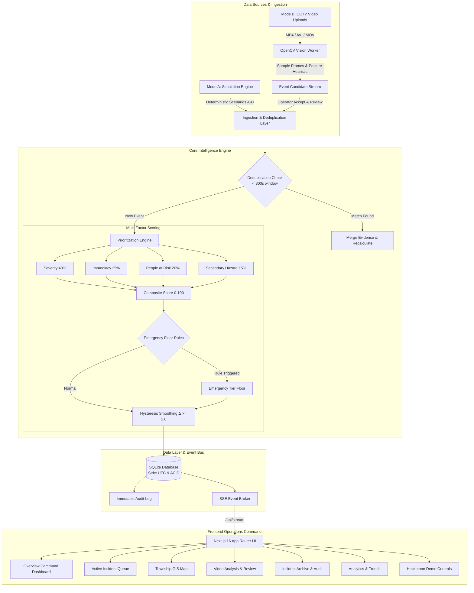
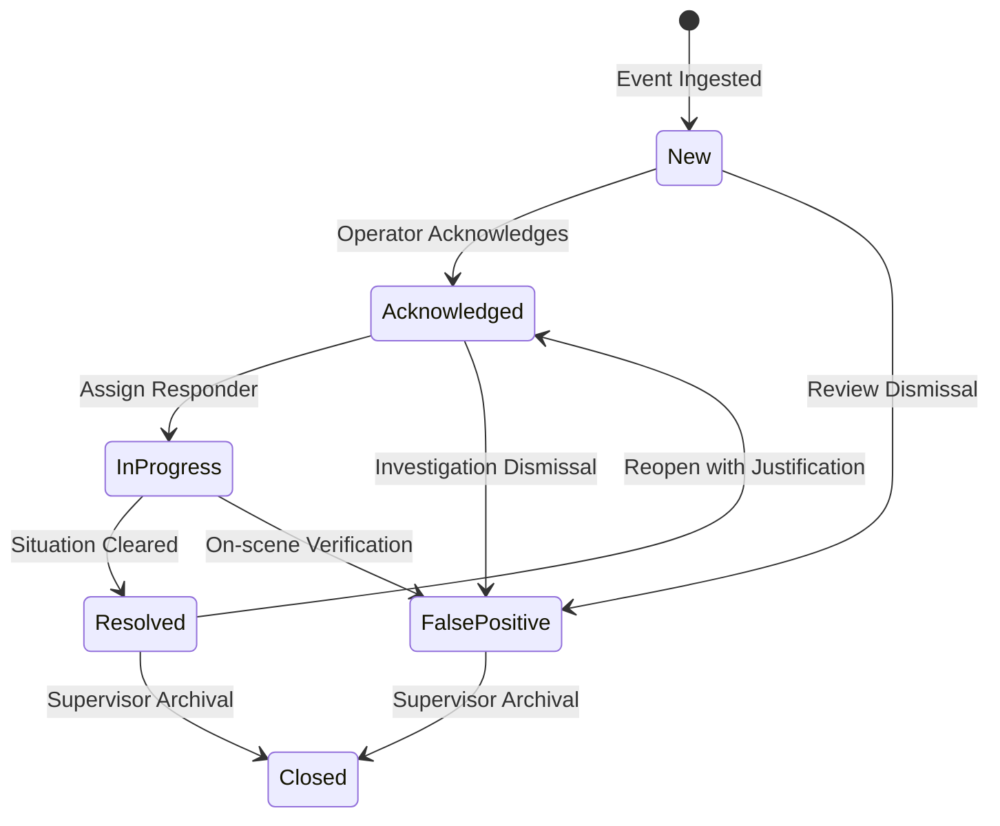

# Township Guardian AI — Architecture & Technical Design

## 1. Executive Summary

**Township Guardian AI** is an intelligent township incident detection, dynamic prioritization, and emergency response management platform built for the **Sime Darby Property University Hackathon 2026** under the theme **Township of Tomorrow (PEOPLE: Safety & Security)**.

Unlike conventional CCTV monitoring software or static rule-based notification systems, Township Guardian AI introduces **Dynamic Incident Intelligence**: a real-time prioritization engine that continuously calculates the relative urgency of concurrent township events, re-evaluates priorities when situational evidence changes, and generates human-oriented explanations with advisory next steps.

---

## 2. High-Level System Architecture

---

## 3. Dynamic Incident Intelligence: Prioritization Engine

### 3.1 Composite Formula
The prioritization engine evaluates each incident across four standardized, orthogonal dimensions:

$$\text{Priority Score} = 0.40 \times \text{Severity} + 0.25 \times \text{Immediacy} + 0.20 \times \text{PeopleAtRisk} + 0.15 \times \text{SecondaryHazard}$$

Where each dimension is normalized to a $[0, 100]$ interval:
- **Severity ($w_1 = 0.40$):** Inherent life hazard of the category (e.g. Person fall / cardiac collapse = 75 base, vehicle collision = 65, illegal dumping = 20).
- **Immediacy ($w_2 = 0.25$):** Time-progression urgency (e.g. person motionless $>60\text{s} \to +20$, lake embankment proximity $\to +15$, fire spreading $\to +30$).
- **People at Risk ($w_3 = 0.20$):** Vulnerable individuals or bystander presence ($0 \to \text{high vulnerability}$, $1-3 \to \text{moderate}$, crowd $\to \text{high}$).
- **Secondary Hazard ($w_4 = 0.15$):** Risk of compounding harm (e.g. blocking emergency vehicle gate, water hazard, electrical exposure).

### 3.2 Emergency Floor Rules
Certain conditions bypass the weighted linear sum and enforce an **Emergency Priority Floor**:
1. **Immediate Threat to Life:** `person_fall` where `motionless_seconds > 60` and `no_bystanders = true` enforces a minimum score of $85.0$ and sets `emergency_rule_triggered = true`.
2. **Blocked Emergency Egress:** `vehicle_obstruction` at an emergency gate or ambulance bay enforces a minimum score of $80.0$.
3. **Confirmed Smoke / Fire:** Smoke detected within $10\text{m}$ of residential precinct enforces a minimum score of $85.0$.

### 3.3 Hysteresis Queue Smoothing ($\Delta \ge 2.0$)
To prevent rapid visual bouncing in the operator's queue caused by micro-fluctuations in scores:
- An incident's visual `rank_score` is only updated if:
  1. The composite priority score shifts by $\ge 2.0$ points ($\Delta \ge 2.0$), OR
  2. The discrete priority level changes (e.g. Medium $\to$ High), OR
  3. An emergency rule is triggered or cleared.

---

## 4. Computer Vision Architecture (Mode B)

Township Guardian AI implements an authentic, working computer vision pipeline via OpenCV:

1. **Clip Ingestion:** Operator uploads an MP4/AVI/MOV CCTV clip through `/api/videos`.
2. **Sampling & Codec Validation:** The video worker samples frames every $0.5$ seconds (`frame_sample_interval_seconds: 0.5`) to preserve CPU resources while capturing movement dynamics.
3. **Pedestrian Box Detection:** Uses OpenCV's Histogram of Oriented Gradients (`cv2.HOGDescriptor`) people detector with an aspect-ratio bounding box tracker.
4. **Temporal Posture Heuristic:**
   - Tracks detected bounding boxes over sequential frames.
   - Detects a transition where box aspect ratio $\frac{\text{width}}{\text{height}} \ge 1.3$ (horizontal posture).
   - Verifies stillness: box centroid displacement remains $< 10\text{ px}$ for $\ge 2.0$ seconds.
5. **Candidate Stream & Human Verification:**
   - Video detections are stored as `EventCandidate` objects.
   - Operators review candidates with frame snapshots at `/api/candidates`.
   - Clicking **"Accept & Prioritize"** feeds the detection into the shared multi-factor prioritization engine as a live incident.
   - Clicking **"Reject"** logs the false alarm to SQLite audit without polluting the queue.

---

## 5. Data Integrity & Audit State Machine

Every state change follows a strict lifecycle state machine:

### Audit Guarantees:
- **Zero Silent Mutations:** Every status transition, priority override, assignment, and action note generates an immutable row in `audit_logs`.
- **Strict UTC Timestamps:** All dates are stored in UTC with timezone-aware ISO serialization, displayed in `Asia/Kuala_Lumpur` (MYT).
- **Separation of Simulation vs Real:** Every record carries an `is_simulated` boolean flag, and simulated alerts are visually badged across all UI views.
